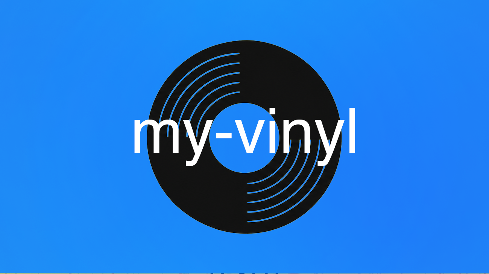

# my-vinyl

Browse any [Discogs](https://www.discogs.com/) user's vinyl collection as a grid of album covers.

**[myvinyl.mattjarrett.dev](https://myvinyl.mattjarrett.dev)**

## Deployment

CI builds an ARM64 image, pushes it to GHCR, then commits the new tag to the `my-vinyl` workspace in [homelab-workspaces](https://github.com/cujarrett/homelab-workspaces). ArgoCD deploys from there.

### Rotating `HOMELAB_WORKSPACES_APP_KEY`

One key serves every repo that deploys to `homelab-workspaces`. [GitHub Tokens → Rotating an App key](https://github.com/cujarrett/homelab/blob/main/docs/github-tokens.md#rotating-an-app-key) sets the new one on all of them in one paste. A missing or revoked key fails `deploy` while `test` and `build-and-push` stay green.
